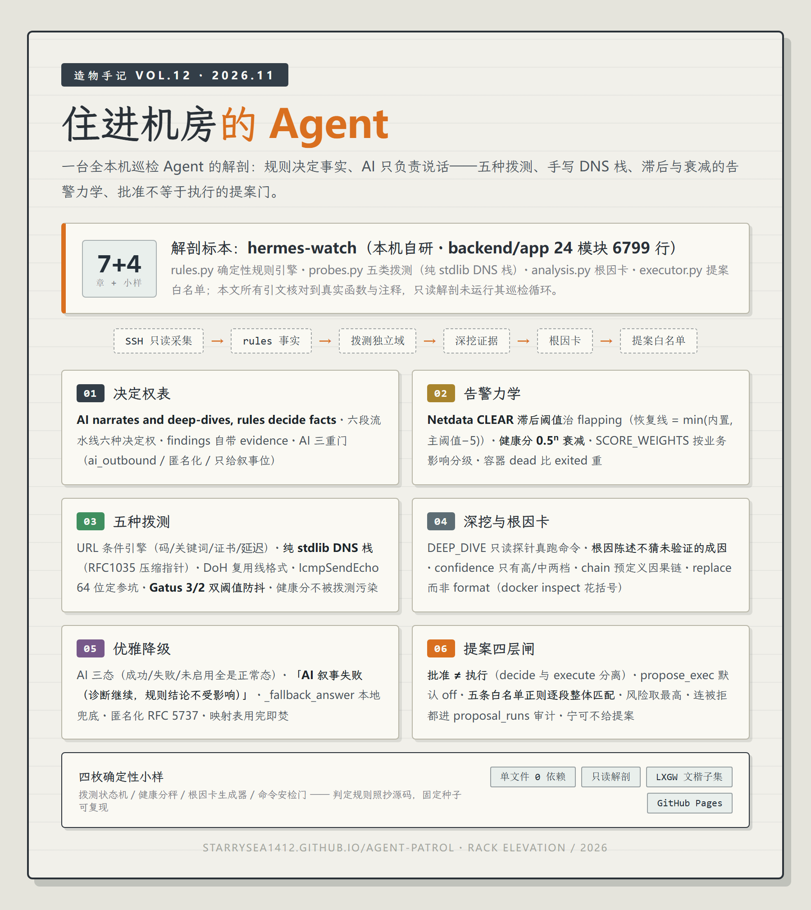

# 住进机房的 Agent · 造物手记 VOL.12

> 一台全本机巡检 Agent 的解剖——规则决定事实、AI 只负责说话：五种拨测、手写 DNS 栈、滞后与衰减的告警力学、批准不等于执行的提案门。

**在线阅读：<https://starrysea1412.github.io/agent-patrol/>**

## 这篇讲什么

Grafana 把巡检锁在云里按条收费，Netdata 的 AI 要订阅。hermes-watch 反着来：住进你自己的机器，backend 24 个模块 6799 行，**确定性规则引擎先于一切大模型**。这篇把它的骨架逐根拆开：

| 章 | 主题 | 关键机制 |
|---|---|---|
| 01 | 规则决定事实，AI 负责说话 | 六段流水线的决定权表 · findings 自带 evidence |
| 02 | 告警也会发抖 | Netdata CLEAR 滞后阈值 · 健康分 0.5ⁿ 衰减 · SCORE_WEIGHTS |
| 03 | 五种拨测与手写 DNS 栈 | 纯 stdlib RFC1035 解析 · DoH 复用线格式 · IcmpSendEcho 64 位坑 · Gatus 3/2 双阈值 |
| 04 | 深挖：证据是跑出来的 | DEEP_DIVE 只读探针 · 根因陈述不猜未验证的成因 |
| 05 | 根因卡与优雅降级 | AI 三态全是正常态 · 「诊断继续，规则结论不受影响」· 匿名化 RFC 5737 |
| 06 | 提案：批准不是执行 | 批准 ≠ 执行 · propose_exec 默认 off · 五条白名单正则逐段校验 |
| 07 | 数据不出本机 | 采集只读 · ai_outbound 两道闸 · 映射表绝不落库 |

## 标本

**hermes-watch**（本机自研）：全本机 AI 服务器巡检面板。本篇只读解剖、未运行其巡检循环；所有引文核对到 rules.py / probes.py / analysis.py / executor.py / collector.py 的真实函数与注释。

## 四枚确定性小样

1. **拨测状态机** —— 3 败下线 / 2 成恢复，逐次点击看防抖吃掉抖动
2. **健康分秤** —— 权重 × 0.5ⁿ 衰减 vs 线性叠加，两条曲线当场分岔
3. **根因卡生成器** —— 选发现类型看 chain/steps/根因，AI 三态切换
4. **命令安检门** —— 五条白名单正则逐段判定，`&&` 拼接一段不中全单拒绝

无外部随机数，参数摊在明面上。

## 系列

造物手记 VOL.12。往期：[VOL.11 当 Agent 指挥 Agent](https://starrysea1412.github.io/agent-orchestrator/) · [VOL.10 给 Agent 配一台总机](https://starrysea1412.github.io/agent-switchboard/) · [VOL.09 把文字画成像素](https://starrysea1412.github.io/canvas-editor-anatomy/) · [VOL.06 给 Agent 打分](https://starrysea1412.github.io/agent-eval/)

---

单文件站点（`index.html` ≈93KB），零依赖。字体 [LXGW 文楷](https://github.com/lxgw/LxgwWenKai)（OFL 许可）。插图由 GPT 系图像模型生成。
